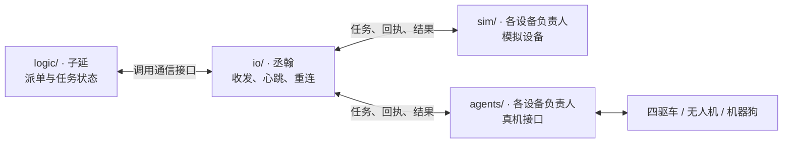

# 模块关系

目录和负责人见 [README](../README.md#目录与工作区)。系统主要分 3 部分：中控调度决定派什么任务，中控通信负责收发，设备程序负责执行和回报。

`app/` 把调度和通信组装成中控程序，`proto/` 保存各模块共用的消息类型。中控已支持单次 GUIDE 的本机 UDP 联调，图中自动派单、心跳和重连仍待实现。模拟设备与真机接口分别用于模拟联调和实机运行，模拟器不连接真实设备。

以通道堵塞为例，机器狗程序上报 EVENT，中控通信交给调度；调度生成无人机 OBSERVE 和四驱车 GUIDE 两项任务，通信分别发出。设备先返回 ACK 表示接受或拒绝，接受后执行，再用 RESULT 报告结果。两项任务分别跟踪，一项失败不影响另一项记录结果。

`scripts/sim_car.py` 可作为独立 UDP 对端测试小车消息，不依赖小车程序；完整的多设备调度链路仍待实现。
