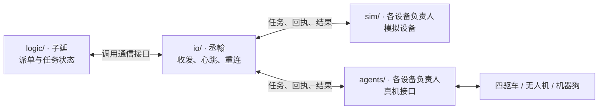

# 模块关系

目录和负责人见 [README](../README.md#目录与工作区)。系统主要分 3 部分：中控调度决定派什么任务，中控通信负责收发，设备程序负责执行和回报。

图中是待实现的通信关系。`app/` 把调度和通信组装成中控程序，`proto/` 保存各模块共用的消息类型。模拟设备与真机接口分别用于模拟联调和实机运行，模拟器不连接真实设备。

以通道堵塞为例，机器狗程序上报 EVENT，中控通信交给调度；调度生成无人机 OBSERVE 和四驱车 GUIDE 两项任务，通信分别发出。设备先返回 ACK 表示接受或拒绝，接受后执行，再用 RESULT 报告结果。两项任务分别跟踪，一项失败不影响另一项记录结果。

`io/mock/` 只用于中控内部测试：可以手动放入设备消息、取出调度发送的请求，让调度开发不必等待网络完成。真正的多进程联调使用 `sim/`，消息走 UDP。当前代码仍是骨架，这条完整链路尚未打通。
