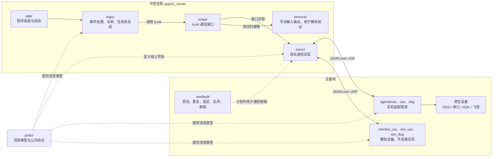

# 架构与目录

多机器人中控接收设备侧事件，由调度逻辑决定派发观察或引导任务，再通过通信层把任务送到对应设备。仓库按“共享协议、中控调度、传输实现、设备适配、仿真验证”拆开目录，使各组成员可以围绕稳定接口并行开发。

当前已提供工程骨架、公共消息类型、IO 接口和手动 mock；UDP、派单、设备执行和故障注入仍待实现。下图展示目标架构，实线表示调用或消息传递，虚线表示共享定义。

请求方向是：调度逻辑产生 `Task` 或 `Cancel`，经由 `ILink` 交给具体传输实现，再到达模拟器或设备 agent。反方向是：设备侧上报事件、回执、结果与链路消息，IO 层解析后连同本地判断的通信事实交给调度。`send()` 返回 `queued` 只表示消息由本地队列接管，不能当作设备已受理或执行完成。设备 agent 负责把公共消息翻译成 ROS、串口、SDK 或飞控调用，并负责本地失控保护；`sim/sim_*` 在联调阶段扮演同类设备端点。

## 目录职责

| 位置 | 当前内容 | 职责与依赖 | 新手从哪里开始 |
|---|---|---|---|
| `.github/` | PR 模板和跨平台构建工作流 | 统一提交说明，并在 Ubuntu、Windows 上配置、构建、测试；它依赖根 CMake 入口。 | 提交前阅读 PR 模板；只有修改 CI 时编辑工作流。 |
| `proto/` | `messages.hpp`，以及 `c2_protocol` 接口目标 | 全组共享消息模型，定义事件、任务、确认、结果、心跳和恢复状态。其他模块引用它，协议变更会影响所有端点；JSON 编解码、校验和 ID 生成尚未实现。 | 先读 `proto/messages.hpp` 和 `docs/01-接口协议.md`，再查看准备修改的调用方。 |
| `io/` | `c2_io` 接口目标及 `mock` 子目录 | 隔离调度与传输，负责截止内的消息重传；是否重新派发业务任务、换任务 ID 由调度决定。 | 先读 `io/api/ilink.hpp`，再进入 mock 或真实实现。 |
| `io/api/` | `ilink.hpp` | 定义发送、订阅、通信统计和 `IoEvent` 契约，是 `logic/` 唯一需要的通信入口。逻辑不应直接依赖 UDP、socket 或设备 SDK。 | 从 `ILink`、`SendStatus`、`IoFact`、`IoEvent` 和 `LinkStats` 读懂消息进出边界。 |
| `io/mock/` | `MockLink` 与对应的单线程手动替身 | 让调度和测试在没有网络时运行。`take_sent()` 取出本地发送队列，`inject()` 注入设备消息或故障事实；它不自动模拟网络成功。 | 先用 `MockLink` 写一个事件到派单的测试，再接触真实通信。 |
| `io/src/` | 仅有实现说明 | 真实通信实现的位置，目标是 JSON 编解码、UDP、队列、截止、重传、去重、心跳和恢复。它实现 `ILink`，复用 `proto/` 的消息定义。 | 先按 `docs/01-接口协议.md` 明确可观察行为，再实现最小发送、接收和截止路径。 |
| `logic/` | 空接口目标和职责说明 | 负责事件处理、派单、任务状态、重试决策和恢复流程。它只依赖 `c2_io` 与公共消息，不直接操作设备；首条可用闭环是 `A_BLOCKED → OBSERVE/GUIDE`。 | 从状态机边界开始：收到哪些事件、产生哪些任务、何时进入终态。先用 `MockLink` 验证。 |
| `agents/car/` | 四驱车接入说明 | 接收 `GUIDE`、`CANCEL`，对接 ROS 导航，返回 `ACK`、`RESULT`，并提供本地失控保护。它实现设备侧业务，不承担中控派单。 | 先确认导航目标、完成条件和取消语义，再接入四驱车原生接口。 |
| `agents/uav/` | 无人机接入说明 | 接收 `OBSERVE`、`CANCEL`，对接飞控，返回 `ACK`、`RESULT`，并提供本地失控保护。 | 先确认飞控型号、消息格式、端口和观察任务接口。 |
| `agents/dog/` | 机器狗接入说明 | 通过 SDK/DDS 上报堵塞与心跳，并提供本地失控保护；当前 Go2 X 权限和网络配置仍待确认。 | 先验证事件来源、权限和网络，再接入堵塞上报。 |
| `sim/` | 三个设备模拟器的 CMake 目标 | 提供不依赖实机的设备端替身。各模拟器当前只链接公共编译选项和协议，尚未链接通信实现。 | 先选择目标设备，再沿着同一设备的 `agents/<设备>/` 与 `sim/sim_<设备>/` 对照阅读。 |
| `sim/sim_car/` | `sim_car` 打印入口 | 目标是模拟四驱车接收 `GUIDE`、返回确认与结果并发送心跳；当前没有 UDP 或任务执行。 | 按四驱车 agent 的接口实现模拟行为，用它替换实机联调。 |
| `sim/sim_uav/` | `sim_uav` 打印入口 | 目标是模拟无人机接收 `OBSERVE`、返回确认与结果并发送心跳；当前没有 UDP 或任务执行。 | 按无人机 agent 的接口实现模拟行为。 |
| `sim/sim_dog/` | `sim_dog` 打印入口 | 目标是模拟机器狗上报 `A_BLOCKED`、处理收讫确认并发送心跳；当前没有 UDP 或事件上报。 | 按机器狗 agent 的上报流程实现模拟行为。 |
| `sim/fault/` | 故障注入说明 | 计划验证丢包、重复、延迟、乱序和指定设备双向断联，观察通信层与调度层能否正确恢复。 | 在设计故障场景前先明确期望的 `IoFact` 和任务状态变化。 |
| `app/` | `c2_center` 程序入口 | 组装公共类型、调度层和通信实现，是团队系统组装位置。当前只构造 `MockLink` 并打印能力状态；真实运行时应在装配处选择 mock 或 `io/src/` 实现。 | 先看 `app/CMakeLists.txt` 的链接关系，再看 `main.cpp` 的启动顺序。 |
| `configs/` | 配置说明 | 存放共享示例配置；地址、设备 ID 等运行参数的未来入口在这里。秘密配置放已忽略的 `local/` 或 `*.local.json/yaml`，配置加载尚未实现。 | 修改默认示例前先确认字段能被程序读取；不要把秘密写入共享文件。 |
| `scripts/` | `check.ps1` | 封装 CMake 配置、构建和 CTest，供成员本地复现 CI 的主要检查。 | 在 Windows Developer PowerShell 中运行 `./scripts/check.ps1`。 |
| `tests/` | `mock_contract_test` | 保护 `MockLink` 的可观察契约，例如队列受理不等于投递、过期消息不入队、订阅生命周期和缺少统计样本。 | 新增行为时先找到对应契约测试；用测试表达预期，再改实现。 |
| `docs/` | 架构、接口协议和设备资料 | 面向全组记录系统边界、线上字段、执行语义和设备接入事实。代码改变公共行为时必须同步更新相关文档。 | 按 `00-架构与目录` → `01-接口协议` → `02-设备资料核查` 阅读。 |
| `materials/` | 资料说明与原始文件目录清单 | 原始设备资料存放在 Release 附件中，与代码分别下载。 | 按任务选择协议与源码、整套源码包或硬件资料。 |
| `CMakeLists.txt` | 根构建定义 | 选择 C++17、设置输出目录和统一警告，添加 `proto`、`io`、`logic`、`sim`、`app`，测试开启时再添加 `tests`。 | 先用它确认目标之间的构建依赖，再进入对应子目录。 |
| `CMakePresets.json` | dev 构建预设 | 固定 Ninja、Debug、测试开关与输出位置，供命令行复用。 | README 中的 `--preset dev` 使用此文件。 |

## 构建依赖与阅读顺序

当前编译依赖是 `c2_center → c2_logic → c2_io → c2_protocol`，`c2_io_mock → c2_io`，测试再通过 `c2_io_mock` 验证通信契约；三个模拟器目前只依赖 `c2_protocol` 和公共编译选项。这个依赖方向让上层依赖接口，让接口实现依赖协议，避免调度逻辑被某个传输库绑定。

新成员可按自己的任务选一条路径。先建立全貌时，依次阅读根 `README.md`、`app/main.cpp`、`io/api/ilink.hpp` 和 `docs/01-接口协议.md`；做调度时，从 `logic/README.md` 与 mock 契约测试开始；做通信时，从 `io/README.md`、`io/api/` 和协议文档开始；做设备时，成对阅读对应 `agents/<设备>/` 与 `sim/sim_<设备>/`。无论走哪条路径，都应以现有接口和设备资料作为事实来源，并明确区分“骨架已提供”和“目标行为待实现”。
