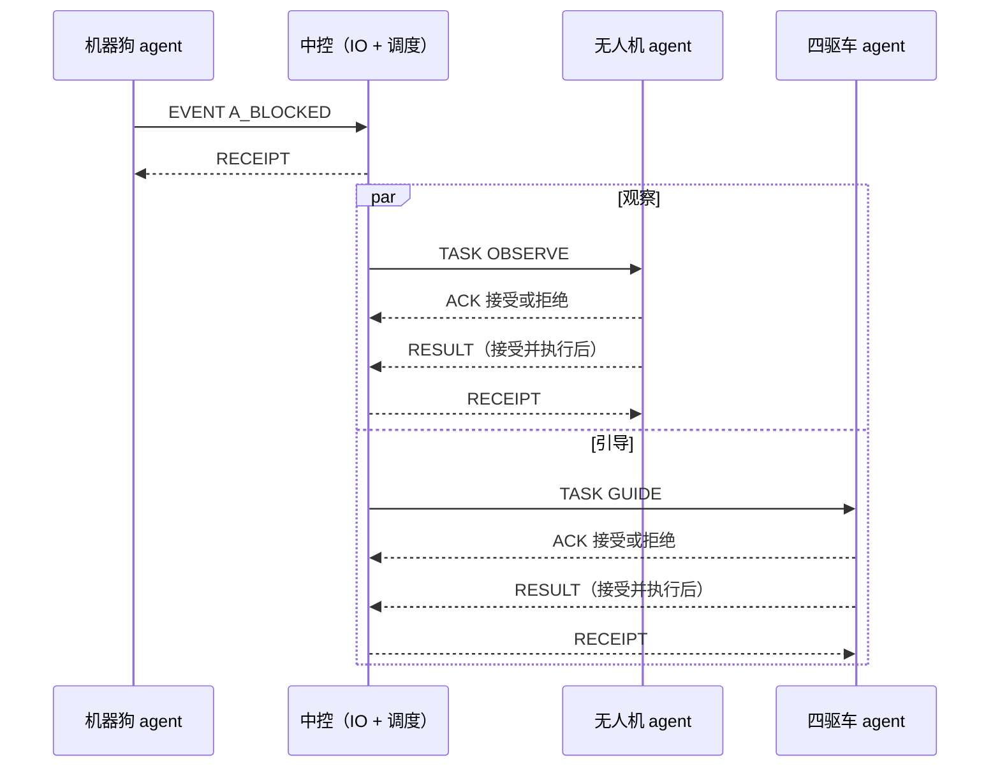

# 接口协议 v0.2（草案）

类型见 `proto/messages.hpp`；编解码与运行行为待实现。

## 先理解一次任务

这份协议约定中控与设备侧程序如何交换消息，供通信、调度和设备负责人共同实现。设备侧程序称为 agent：它接收统一任务，再调用 ROS、飞控或机器狗 SDK。模拟器扮演同样的设备侧角色，用于没有实机时的联调。

任务流程中必须分清 3 件事：中控把请求放入本地队列、设备接受任务、设备执行结束。它们分别对应 send 返回 QUEUED、ACK(accepted=true)、RESULT。无人机收到观察任务后，也可能因能力不支持返回拒绝 ACK；“收到”并不表示“成功”。

图中省略心跳、重传和错误分支。ACK 是业务受理回执，RECEIPT 仅表示消息已收讫，目的是让发送方停止重传事件或结果。RESULT 是一次任务的最终结论，可重复发送同一个结果，但不能先报成功再改成失败。

## 标识如何关联

| 标识 | 标识什么 | 示例关系 |
|---|---|---|
| trace_id | 一次源事件及其全部派生任务 | 同一次堵塞产生的观察、引导任务使用同一个 trace_id |
| task_id | 一项业务任务 | 观察和引导使用不同 task_id；任务重传时不变 |
| msg_id | 一条消息 | TASK、ACK、RESULT 各有自己的 msg_id；同一消息重传不变 |
| session_id | 一次进程运行 | agent 关闭再启动后变化，用于识别重启和迟到消息 |

源事件由上报设备生成 trace_id，任务 ID 由中控调度生成。无事件触发的主动任务用 task_id 作为 trace_id。ACK/RECEIPT 中的 ack_for_msg_id 指向正在确认的那条消息。

## 封装

中控 ↔ 设备 agent 使用 JSON over UDP，每个数据报 1 个消息，UTF-8，最多 1200 字节。设备 ID 与地址静态配置。

| 字段 | 类型 / 约定 |
|---|---|
| `version` | uint16，当前为 1 |
| `type` | EVENT / TASK / CANCEL / ACK / RESULT / RECEIPT / LINK |
| `msg_id` | 32 位小写十六进制随机 ID；重传不变 |
| `session_id` | 发送进程 ID，重启变化 |
| `dst_session_id` | 接收进程 ID；仅发现用 HEARTBEAT 可为 null |
| `src_id`、`dst_id` | 发送方、接收方设备 ID |
| `trace_id` | 源事件 ID；派生消息继承，无源任务等于 task_id；LINK 可为 null |
| `ts_mono_ms` | uint64，发送方本地单调时钟，不跨进程比较 |
| `body` | 下表定义的对象 |

`task_id`、`trace_id`、session ID 均使用 32 位小写十六进制随机 ID。

## 消息体

| 类型 | body 字段 | 确认 |
|---|---|---|
| EVENT | `event_code:string, severity:uint8, payload:object` | RECEIPT |
| TASK | `task_id:string, action:string, params:object, expire_at_unix_ms:uint64, max_clock_skew_ms:uint32, execution_timeout_ms:uint32` | ACK |
| CANCEL | `task_id:string, reason:string, expire_at_unix_ms:uint64, max_clock_skew_ms:uint32` | ACK；独立 msg_id，继承任务 trace_id |
| ACK | `ack_for_msg_id:string, task_id:string, accepted:bool, reject_reason:string或null` | 不再确认 |
| RESULT | `task_id:string, status:string, detail:object` | RECEIPT |
| RECEIPT | `ack_for_msg_id:string` | 不再确认；回带原 trace_id |
| LINK | 见下表 | 心跳周期发送，查询丢失后重试 |

ACK 接受时 reject_reason 为 null，拒绝时必填。RESULT 为 SUCCESS / FAILED / ABORTED；设备执行超时为 FAILED，`detail.reason=EXECUTION_TIMEOUT`。

| LINK.kind | 其他 body 字段 |
|---|---|
| HEARTBEAT | `hb_seq:uint32` |
| RESYNC_REQUEST | `request_id:string, task_id:string`；空 task_id 表示会话核对 |
| RESYNC_STATE | `request_id:string, task_id:string, task_state:string, task_ack:object或null, result:object或null` |

task_state 为 UNKNOWN / REJECTED / RUNNING / TERMINAL。RUNNING、TERMINAL 必带原 TASK 的 ACK body；REJECTED 带拒绝 ACK，仅取消先到且 TASK 未到时可为 null；TERMINAL 带 RESULT body。回复继承任务 trace_id，未知任务回带请求 trace_id。限制 detail 大小，保证恢复消息也不超过 1200 字节。

## 动作与原因码

| 动作 | 目标 | params 示例 |
|---|---|---|
| OBSERVE | 无人机 | `{"area":"A","alt_m":15,"loiter_s":60}` |
| GUIDE | 四驱车 | `{"channel":"A","target":"A_exit","speed_mps":0.5}` |

事件：A_BLOCKED / B_BLOCKED / C_BLOCKED / LOW_BATTERY / ARRIVED / FAULT；severity 为 0=info、1=warn、2=critical。堵塞 payload 示例：`{"channel":"A","block_ratio":0.8}`。

拒绝码：BUSY、MODE_MISMATCH、CAPABILITY、BAD_PARAM、EXPIRED、CLOCK_UNSYNCED、UNKNOWN_TASK、CANCELLED、ALREADY_FINISHED、ID_CONFLICT。

## 执行约定

下面约束处理的是网络丢包、延迟和断线：没有收到 ACK，既可能是 TASK 丢了，也可能是设备已开始执行但 ACK 丢了。因此重传必须保持任务身份，状态不明时先查询，不能直接当成设备未执行。

1. **发送与受理。** send 返回 QUEUED / REJECTED / EXPIRED，仅表示本地状态。设备 ACK 才表示受理或拒绝；有效 RESULT 也证明 TASK 已到达。传输成功或 RECEIPT 不等于任务受理。
2. **投递截止。** 线上使用 UTC Unix 毫秒，本地队列与计时使用 steady_clock。设备首次受理前要求 `now_unix_ms + max_clock_skew_ms < expire_at_unix_ms`，且已知时钟偏差不超过该上界；否则拒绝。单机可用 0；时钟跳变后暂停受理并重新核对。每次发送前检查截止，过期不补发。
3. **执行时限。** 从设备首次受理开始计时。中控从收到 ACK 开始等待相同执行时长及配置宽限；等待超时只标“结果未知”，不代表设备停止。设备到期停止任务或触发本地安全策略并上报结果，不能确认已停止时不声称停止成功；观察任务时限需覆盖飞行与盘旋时间。
4. **重传。** 默认间隔 200 ms；TASK/CANCEL 仅在截止前重传。EVENT/RESULT 在线重试 60 s，仍未确认则报 REPORT_UNCONFIRMED，保留记录，恢复后补报。RECEIPT 表示接收进程已接管，不保证崩溃持久化。
5. **去重。** msg_id 去重消息，`(中控ID, task_id)` 去重任务；记录保留至 agent 进程结束。重复任务不重执行、不重启计时；改变动作、参数或执行时限报 ID_CONFLICT。新 msg_id 引用原 task_id 时复用原决定，ACK 指向本次请求；同 msg_id 重传才重放原 ACK。被拒任务不在同 task_id 下改判受理；重复 EVENT 不重复派单。
6. **终态。** 一个任务只产生一个不可变终态，RESULT 可重传。RESULT 先于 ACK 到达可直接收尾，迟到 ACK 不回退状态；重复终态只回 RECEIPT，矛盾终态报协议错误。
7. **取消。** ACK(true) 仅表示接受取消，停止后才发 ABORTED；正常完成先发生时可为 SUCCESS。已完成返回 ALREADY_FINISHED 并重放 RESULT；不支持返回 CAPABILITY。有效 CANCEL 先到时返回 UNKNOWN_TASK，保存取消记录，后到 TASK 拒绝为 CANCELLED；过期 CANCEL 不建记录。
8. **未知状态。** 从未尝试发送的过期请求记 EXPIRED_UNSENT；尝试发送但无回执记 DELIVERY_UNKNOWN。未知时先查询，不直接换 task_id 重派。

## 心跳与恢复

UDP 本身没有连接状态，心跳用于判断对端是否仍在线；“恢复”还包括核对进程是否重启、原任务是否仍在执行。收到一个心跳不能直接恢复派单。

双向心跳每 1 s 发送，连续 3 s 无有效消息判 LINK_DOWN。恢复时暂停派单，按未决 task_id 查询，默认等 3 s；超时保持恢复中。

新 HEARTBEAT 只提出候选 session。中控发送绑定双方 session 的 RESYNC_REQUEST，设备验证地址和 session 后回复并接纳中控，中控验证 request_id 后接纳设备；退役 session 不再激活，目标 session 不匹配的业务消息丢弃。空 task_id 的会话核对回复 UNKNOWN。任务快照可从 RUNNING 推进为 TERMINAL，不回退已知终态；终态通过原 RESULT 补报并等 RECEIPT。

同 session 返回 UNKNOWN 表示没有任务记录；session 变化后 UNKNOWN 不能证明任务未执行，保持未知。会话核对后可保留 msg_id/body、重绑目标 session 补报 EVENT/RESULT，TASK/CANCEL 不自动重投。全部核对完成才报 LINK_UP。进程重启后的持久化恢复不在首版范围。

IO 上报通信事实并透传业务消息；调度决定重试或放弃；设备负责执行和本地失控保护。遥测只保最新帧，载荷走独立通道；frame_age 表示距最近有效遥测到达本地的时间，无样本为空。

## 各模块实现什么

| 模块 | 实现责任 |
|---|---|
| 公共协议 proto/ | 所有人共用消息类型；编解码须匹配本文字段与线上字符串 |
| 中控 IO | 收发、校验、截止内重传、消息去重、心跳与会话恢复；向调度报告通信事实 |
| 调度 logic/ | 按事件生成任务、记录状态，决定任务级重试或放弃；不绕过 IO 直连设备 |
| agent / sim | 判断是否接受任务、避免重复执行、返回终态，并配合确认与恢复 |

联调先验证正常事件链路，再检查重复 TASK 不重复执行、ACK/RESULT 丢失后可补齐、过期任务不执行，以及断线恢复后原任务状态不被重置。实机停止、悬停或降落方式由对应设备能力决定。
