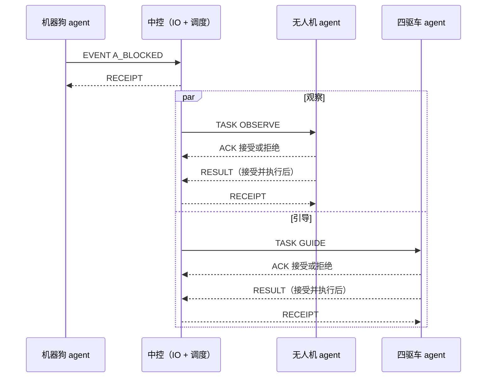

# 接口协议 v0.2（草案）

类型见 `proto/messages.hpp`。当前实现单机 UDP、JSON 编解码和中控单次 GUIDE；自动派单、自动重传、消息去重和会话恢复仍是下面的目标约定，尚未实现。

## 目录

- [首轮单机联调](#首轮单机联调)：设备 ID、地址和端口
- [一次任务的流程](#先理解一次任务)：事件、派单、回执与结果
- [标识如何关联](#标识如何关联)：`trace_id`、`task_id`、`msg_id`、`session_id`
- [公共字段](#封装)：每条消息的外层字段
- [消息体](#消息体)：各类消息的 `body` 字段与用途
  - [EVENT](#event设备上报事件) · [TASK](#task中控下发任务) · [CANCEL](#cancel中控请求取消任务)
  - [ACK](#ack设备回复是否受理) · [RESULT](#result设备上报执行结果) · [RECEIPT](#receipt确认收到消息) · [LINK](#link状态查询)
- [动作与原因码](#动作与原因码)：`OBSERVE`、`GUIDE` 和拒绝原因
- [执行约定](#执行约定)：受理、截止、重传、去重和取消
- [状态查询](#状态查询)：查询和恢复任务状态
- [各模块实现什么](#各模块实现什么)：通信、调度与设备侧分工
- [小车联调示例](#小车联调示例)：TASK、ACK、RESULT 和运行方法

## 首轮单机联调

本轮四个进程固定使用下列 ID 和本机 IPv4 地址。各进程绑定自己的 UDP 端口接收，也从该端口发送；中控根据源地址和端口核对发送方。命令行可修改端口，四端必须使用同一组配置。其他电脑或实机不适用 127.0.0.1，需要后续增加网络地址配置。

| 进程 | ID | 默认监听地址 | 中控命令行参数 |
|---|---|---|---|
| 中控 | `c2` | `127.0.0.1:19000` | `--center-port` |
| 四驱车 | `car_01` | `127.0.0.1:19001` | `--car-port` |
| 无人机 | `uav_01` | `127.0.0.1:19002` | `--uav-port` |
| 机器狗 | `dog_01` | `127.0.0.1:19003` | `--dog-port` |

## 先理解一次任务

这份协议约定中控与设备侧程序如何交换消息，供通信、调度和设备负责人共同实现。设备侧程序称为 agent：它接收统一任务，再调用 ROS、飞控或机器狗 SDK。模拟器扮演同样的设备侧角色，用于没有实机时的联调。

任务流程中必须分清 3 件事：中控把请求放入本地队列、设备接受任务、设备执行结束。它们分别对应 send 返回 QUEUED、ACK(accepted=true)、RESULT。无人机收到观察任务后，也可能因能力不支持返回拒绝 ACK；“收到”并不表示“成功”。



图中省略重传和错误分支。ACK 是业务受理回执，RECEIPT 仅表示消息已收讫，目的是让发送方停止重传事件或结果。RESULT 是一次任务的最终结论，可重复发送同一个结果，但不能先报成功再改成失败。

## 标识如何关联

| 标识 | 标识什么 | 示例关系 |
|---|---|---|
| trace_id | 一次源事件及其全部派生任务 | 同一次堵塞产生的观察、引导任务使用同一个 trace_id |
| task_id | 一项业务任务 | 观察和引导使用不同 task_id；任务重传时不变 |
| msg_id | 一条消息 | TASK、ACK、RESULT 各有自己的 msg_id；同一消息重传不变 |
| session_id | 一次进程运行 | agent 关闭再启动后变化，用于识别重启和迟到消息 |

源事件由上报设备生成 trace_id，任务 ID 由中控调度生成。无事件触发的主动任务用 task_id 作为 trace_id。ACK/RECEIPT 中的 ack_for_msg_id 指向正在确认的那条消息。

## 封装

中控 ↔ 设备 agent 使用 JSON over UDP，每个数据报 1 个消息，UTF-8，最多 1200 字节。设备 ID 与地址静态配置。

| 字段 | 类型 / 约定 |
|---|---|
| `version` | uint16，当前为 1 |
| `type` | EVENT / TASK / CANCEL / ACK / RESULT / RECEIPT / LINK |
| `msg_id` | 32 位小写十六进制随机 ID；重传不变 |
| `session_id` | 发送进程 ID，重启变化 |
| `dst_session_id` | 接收进程 ID；首轮联调允许 TASK 为 null，设备回复时回带中控的 `session_id` |
| `src_id`、`dst_id` | 发送方、接收方设备 ID |
| `trace_id` | 源事件 ID；派生消息继承，无源任务等于 task_id；LINK 可为 null |
| `ts_mono_ms` | uint64，发送方本地单调时钟，不跨进程比较 |
| `body` | 下表定义的对象 |

`task_id`、`trace_id`、session ID 均使用 32 位小写十六进制随机 ID。

## 消息体

| 类型 | body 字段 | 确认 |
|---|---|---|
| EVENT | `event_code:string, severity:uint8, payload:object` | RECEIPT |
| TASK | `task_id:string, action:string, params:object, expire_at_unix_ms:uint64, max_clock_skew_ms:uint32, execution_timeout_ms:uint32` | ACK |
| CANCEL | `task_id:string, reason:string, expire_at_unix_ms:uint64, max_clock_skew_ms:uint32` | ACK；独立 msg_id，继承任务 trace_id |
| ACK | `ack_for_msg_id:string, task_id:string, accepted:bool, reject_reason:string或null` | 不再确认 |
| RESULT | `task_id:string, status:string, detail:object` | RECEIPT |
| RECEIPT | `ack_for_msg_id:string` | 不再确认；回带原 trace_id |
| LINK | 见下表 | 状态查询与回复；尚未实现 |

`body` 是消息的具体内容，上表说明每类消息包含哪些字段；下面说明字段的用途。相同名称在不同消息中的含义相同。

### EVENT：设备上报事件

| 字段 | 用途 |
|---|---|
| `event_code` | 事件类型，例如 `A_BLOCKED` 表示 A 通道堵塞；调度根据事件类型决定是否派单。 |
| `severity` | 严重程度：`0` 为普通信息，`1` 为警告，`2` 为严重。 |
| `payload` | 事件的补充数据；内容随事件类型变化，例如 `{"channel":"A","block_ratio":0.8}`。 |

### TASK：中控下发任务

| 字段 | 用途 |
|---|---|
| `task_id` | 任务的唯一标识；设备在 ACK 和 RESULT 中回带，中控据此关联任务。 |
| `action` | 要执行的动作，例如无人机 `OBSERVE`、四驱车 `GUIDE`。 |
| `params` | 动作所需参数；内容由 `action` 决定，例如引导任务的通道、目标和速度。 |
| `expire_at_unix_ms` | 投递截止时间，UTC Unix 毫秒；设备首次受理任务时若已过期，应拒绝执行。 |
| `max_clock_skew_ms` | 允许的中控与设备之间的最大时钟偏差，单位毫秒；设备无法保证该偏差时拒绝任务。 |
| `execution_timeout_ms` | 设备首次受理后允许执行的最长时间，单位毫秒；它与投递截止时间是两个不同的时限。 |

例如，`expire_at_unix_ms` 决定任务最晚何时可以被接受，`execution_timeout_ms` 决定接受后最多执行多久。

### CANCEL：中控请求取消任务

| 字段 | 用途 |
|---|---|
| `task_id` | 要取消的原任务 ID。 |
| `reason` | 取消原因，供设备和日志使用。 |
| `expire_at_unix_ms` | 取消请求的投递截止时间，UTC Unix 毫秒；过期后设备不应首次受理。 |
| `max_clock_skew_ms` | 允许的中控与设备之间的最大时钟偏差，单位毫秒。 |

### ACK：设备回复是否受理

| 字段 | 用途 |
|---|---|
| `ack_for_msg_id` | 被回复的 TASK 或 CANCEL 的 `msg_id`，用于匹配具体请求。 |
| `task_id` | 请求对应的任务 ID。 |
| `accepted` | `true` 表示设备接受请求；`false` 表示拒绝。接受任务不等于执行成功。 |
| `reject_reason` | 拒绝原因码；`accepted=true` 时为 `null`，为 `false` 时必填，例如 `BUSY`。 |

### RESULT：设备上报执行结果

| 字段 | 用途 |
|---|---|
| `task_id` | 已执行任务的 ID，用于关联原 TASK。 |
| `status` | 最终结果：`SUCCESS` 成功、`FAILED` 失败、`ABORTED` 已中止。 |
| `detail` | 结果的补充信息，例如 `{"arrived":true}`；执行超时时可写 `{"reason":"EXECUTION_TIMEOUT"}`。 |

### RECEIPT：确认收到消息

| 字段 | 用途 |
|---|---|
| `ack_for_msg_id` | 已收到的 EVENT 或 RESULT 的 `msg_id`，让发送方知道哪条消息已被接收。 |

RECEIPT 只确认消息收讫，不表示任务已被接受或执行成功。

### LINK：状态查询

`kind` 区分状态查询请求和回复。状态查询仍是目标约定，尚未实现。

| LINK.kind | 其他 body 字段 |
|---|---|
| RESYNC_REQUEST | `request_id:string, task_id:string`；空 task_id 表示会话核对 |
| RESYNC_STATE | `request_id:string, task_id:string, task_state:string, task_ack:object或null, result:object或null` |

task_state 为 UNKNOWN / REJECTED / RUNNING / TERMINAL。RUNNING、TERMINAL 必带原 TASK 的 ACK body；REJECTED 带拒绝 ACK，仅取消先到且 TASK 未到时可为 null；TERMINAL 带 RESULT body。回复继承任务 trace_id，未知任务回带请求 trace_id。限制 detail 大小，保证恢复消息也不超过 1200 字节。

| 字段 | 用途 |
|---|---|
| `kind` | LINK 的种类：`RESYNC_REQUEST` 状态查询或 `RESYNC_STATE` 查询结果。 |
| `request_id` | 一次状态查询的标识；请求与回复使用相同值，便于配对。 |
| `task_id` | 要查询的任务 ID；查询会话本身时为一个空字符串。 |
| `task_state` | 设备记录的任务状态：`UNKNOWN` 未知、`REJECTED` 已拒绝、`RUNNING` 执行中、`TERMINAL` 已结束。 |
| `task_ack` | 原 TASK 的 ACK 消息体，用于恢复时确认当初是否受理；没有可返回的 ACK 时为 `null`。 |
| `result` | 原任务的 RESULT 消息体，任务有终态时返回；没有终态时为 `null`。 |

## 动作与原因码

| 动作 | 目标 | params 示例 |
|---|---|---|
| OBSERVE | 无人机 | `{"area":"A","alt_m":15,"loiter_s":60}` |
| GUIDE | 四驱车 | `{"channel":"A","target":"A_exit","speed_mps":0.5}` |

事件：A_BLOCKED / B_BLOCKED / C_BLOCKED / LOW_BATTERY / ARRIVED / FAULT；severity 为 0=info、1=warn、2=critical。堵塞 payload 示例：`{"channel":"A","block_ratio":0.8}`。

拒绝码：BUSY、MODE_MISMATCH、CAPABILITY、BAD_PARAM、EXPIRED、CLOCK_UNSYNCED、UNKNOWN_TASK、CANCELLED、ALREADY_FINISHED、ID_CONFLICT。

## 执行约定

下面约束处理的是网络丢包、延迟和断线：没有收到 ACK，既可能是 TASK 丢了，也可能是设备已开始执行但 ACK 丢了。因此重传必须保持任务身份，状态不明时先查询，不能直接当成设备未执行。

1. **发送与受理。** send 返回 QUEUED / REJECTED / EXPIRED，仅表示本地状态。设备 ACK 才表示受理或拒绝；有效 RESULT 也证明 TASK 已到达。传输成功或 RECEIPT 不等于任务受理。
2. **投递截止。** 线上使用 UTC Unix 毫秒，本地队列与计时使用 steady_clock。设备首次受理前要求 `now_unix_ms + max_clock_skew_ms < expire_at_unix_ms`，且已知时钟偏差不超过该上界；否则拒绝。单机可用 0；时钟跳变后暂停受理并重新核对。每次发送前检查截止，过期不补发。
3. **执行时限。** 从设备首次受理开始计时。中控从收到 ACK 开始等待相同执行时长及配置宽限；等待超时只标“结果未知”，不代表设备停止。设备到期停止任务或触发本地安全策略并上报结果，不能确认已停止时不声称停止成功；观察任务时限需覆盖飞行与盘旋时间。
4. **重传。** 默认间隔 200 ms；TASK/CANCEL 仅在截止前重传。EVENT/RESULT 在线重试 60 s，仍未确认则报 REPORT_UNCONFIRMED，保留记录，恢复后补报。RECEIPT 表示接收进程已接管，不保证崩溃持久化。
5. **去重。** msg_id 去重消息，`(中控ID, task_id)` 去重任务；记录保留至 agent 进程结束。重复任务不重执行、不重启计时；改变动作、参数或执行时限报 ID_CONFLICT。新 msg_id 引用原 task_id 时复用原决定，ACK 指向本次请求；同 msg_id 重传才重放原 ACK。被拒任务不在同 task_id 下改判受理；重复 EVENT 不重复派单。
6. **终态。** 一个任务只产生一个不可变终态，RESULT 可重传。RESULT 先于 ACK 到达可直接收尾，迟到 ACK 不回退状态；重复终态只回 RECEIPT，矛盾终态报协议错误。
7. **取消。** ACK(true) 仅表示接受取消，停止后才发 ABORTED；正常完成先发生时可为 SUCCESS。已完成返回 ALREADY_FINISHED 并重放 RESULT；不支持返回 CAPABILITY。有效 CANCEL 先到时返回 UNKNOWN_TASK，保存取消记录，后到 TASK 拒绝为 CANCELLED；过期 CANCEL 不建记录。
8. **未知状态。** 从未尝试发送的过期请求记 EXPIRED_UNSENT；尝试发送但无回执记 DELIVERY_UNKNOWN。未知时先查询，不直接换 task_id 重派。

## 状态查询

状态查询尚未实现。后续需要核对任务时，可使用 RESYNC_REQUEST 按 `task_id` 查询，并由设备用 RESYNC_STATE 回复；如何触发查询、匹配会话和处理超时仍需确定。同一 session 返回 UNKNOWN 表示设备没有该任务记录；设备进程重启后返回 UNKNOWN，不能证明任务未执行。状态未明确时，不直接重新派发任务。

IO 上报通信事实并透传业务消息；调度决定重试或放弃；设备负责执行和本地失控保护。遥测只保最新帧，载荷走独立通道；frame_age 表示距最近有效遥测到达本地的时间，无样本为空。

## 各模块实现什么

| 模块 | 实现责任 |
|---|---|
| 公共协议 proto/ | 所有人共用消息类型；编解码须匹配本文字段与线上字符串 |
| 中控 IO | 收发、校验、截止内重传、消息去重与会话恢复；向调度报告通信事实 |
| 调度 logic/ | 按事件生成任务、记录状态，决定任务级重试或放弃；不绕过 IO 直连设备 |
| agent / sim | 判断是否接受任务、避免重复执行、返回终态，并配合确认与恢复 |

联调先验证正常事件链路，再检查重复 TASK 不重复执行、ACK/RESULT 丢失后可补齐、过期任务不执行，以及断线恢复后原任务状态不被重置。实机停止、悬停或降落方式由对应设备能力决定。

## 小车联调示例

`c2_center --guide` 直接发送一条 TASK，等待 ACK 和 RESULT，并对 RESULT 返回 RECEIPT；它不会自动派单、重传或恢复。首轮先不做会话握手：TASK 的 `dst_session_id` 为 `null`；设备生成自己的 `session_id`，ACK 和 RESULT 的 `dst_session_id` 回带 TASK 的 `session_id`。

示例中的 ID 和时间仅用于展示格式。实际发送新消息时须生成新的 `msg_id`；同一消息重传保持原 `msg_id`，同一进程运行期间保持 `session_id`，关联同一事件的消息保持 `trace_id`，同一任务的消息保持 `task_id`。时间和截止值须使用当前值。

中控 → 小车，TASK：

```json
{"version":1,"type":"TASK","msg_id":"11111111111111111111111111111111","session_id":"22222222222222222222222222222222","dst_session_id":null,"src_id":"c2","dst_id":"car_01","trace_id":"33333333333333333333333333333333","ts_mono_ms":12345,"body":{"task_id":"33333333333333333333333333333333","action":"GUIDE","params":{"channel":"A","target":"A_exit","speed_mps":0.5},"expire_at_unix_ms":1999999999999,"max_clock_skew_ms":0,"execution_timeout_ms":10000}}
```

小车 → 中控，接受任务时先发 ACK；其中 `ack_for_msg_id` 指向 TASK 的 `msg_id`：

```json
{"version":1,"type":"ACK","msg_id":"44444444444444444444444444444444","session_id":"55555555555555555555555555555555","dst_session_id":"22222222222222222222222222222222","src_id":"car_01","dst_id":"c2","trace_id":"33333333333333333333333333333333","ts_mono_ms":45678,"body":{"ack_for_msg_id":"11111111111111111111111111111111","task_id":"33333333333333333333333333333333","accepted":true,"reject_reason":null}}
```

完成后小车 → 中控发送 RESULT；中控会返回 RECEIPT，其中 `ack_for_msg_id` 对应 RESULT 的 `msg_id`：

```json
{"version":1,"type":"RESULT","msg_id":"66666666666666666666666666666666","session_id":"55555555555555555555555555555555","dst_session_id":"22222222222222222222222222222222","src_id":"car_01","dst_id":"c2","trace_id":"33333333333333333333333333333333","ts_mono_ms":46789,"body":{"task_id":"33333333333333333333333333333333","status":"SUCCESS","detail":{"arrived":true}}}
```

在两个终端分别运行 `python scripts/sim_car.py` 和 `build/dev/bin/c2_center --guide`；Windows 下中控文件名为 `c2_center.exe`。小车进程替换脚本时应监听 19001，使用同一 socket 将消息发到 19000。要修改端口时，两端分别传入 `--car-port`、`--center-port`。跨语言只需按 JSON 字段和 UDP 约定对接，不依赖 C++ 接口。
